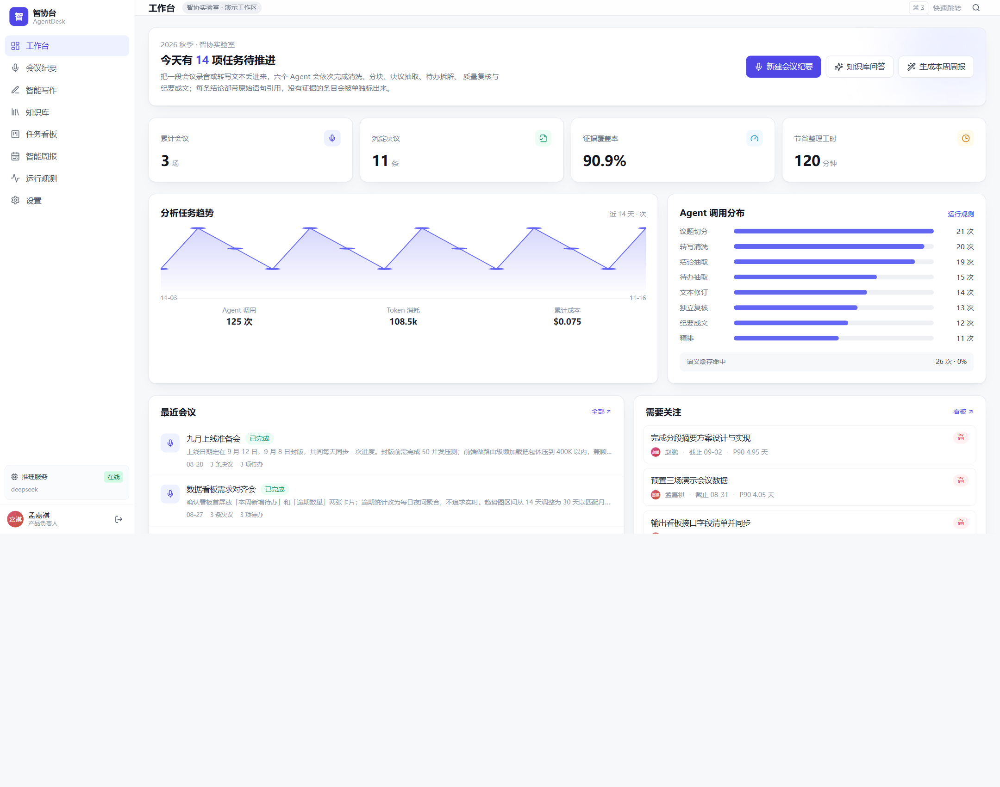

# AgentDesk · 智协台

> 把一场会开成能追踪的决议、待办和可引用的知识。
> AI 协同办公工具：会议转写 → 带证据的纪要 → 可追踪的任务 → 周报 → 可引用的知识库，全过程可审计、可回滚、成本可见。

**技术栈**：React 18 + TypeScript + Vite + Tailwind ｜ FastAPI + SQLAlchemy ｜ SQLite（本地/WAL） ｜ DeepSeek（OpenAI 兼容端点，可换 Ollama）

**在线演示**：https://carbon-newspapers-receives-garbage.trycloudflare.com
（评审账号 `demo@agentdesk.dev` / `Demo@2026`，已预置 3 场会议、16 条任务、3 份知识资料与 14 天运行记录）



---

## 1. 这个项目解决什么问题

团队真正耗时的不是"写东西"，而是信息在三处之间搬运：会议录音里的结论、文档里的细节、看板上的任务。搬运靠人，就会出三种问题：

- **结论失真**：整理者会不自觉地"顺"一遍逻辑，把"先看看"写成"已决定"；
- **待办蒸发**：会上说"这个赵鹏跟一下"，落到文档里只剩一句"跟进相关工作"，没有责任人、没有时间；
- **知识不沉淀**：三个月后新人问"我们的引用阈值是多少"，没人答得上来。

市面上的 AI 会议工具大多解决了"把话变成字"，但没解决"字能不能被信任"。AgentDesk 的出发点是：**AI 的输出必须能点回原始证据**。做不到这一点，纪要越快，团队越不敢用。

## 2. 功能一览

| 模块 | 说明 | 截图 |
|---|---|---|
| 工作台 | KPI（会议/决议/证据覆盖率/节省工时）、14 天分析趋势、Agent 调用分布、最近会议、需关注任务 | [01](docs/screenshots/01-dashboard.png) |
| 会议纪要 | 贴转写 → 六 Agent 流水线 → 议题脉络、决议、待办、摘要；导出 Markdown / Word | [02](docs/screenshots/02-meeting-summary.png) |
| 证据链 | 每条结论挂原文引文、说话人、时间点、置信度；无证据条目降级为"未决" | [03](docs/screenshots/03-evidence-chain.png) |
| Agent Trace | 六个 Agent 逐步的输入摘要、输出摘要、token、耗时、命中缓存、证据条数 | [04](docs/screenshots/04-agent-trace.png) |
| 智能写作 | 一句话指令 → **补丁级**修改建议（改哪句/改成什么/为什么），逐条勾选后应用，附文本体检 | [05](docs/screenshots/05-writer-diff.png) |
| 知识库 | PDF/Word/Markdown/TXT/HTML 上传 → 切片 → BM25 ⊕ 向量 → RRF → 精排 → 流式问答 + 引用强弱标注 | — |
| 任务看板 | 四列状态、负责人、截止日、风险徽标、P50/P90 工期区间 | [06](docs/screenshots/06-task-board.png) |
| 智能周报 | 面板本地聚合秒出，正文按需生成并按数据指纹缓存 | [07](docs/screenshots/07-weekly.png) |
| 运行观测 | 运行次数、token、成本、缓存命中、路由分配、Agent 性能表 | [08](docs/screenshots/08-insights.png) |
| 设置 | 四档模型路由、PII 脱敏、语义缓存、快模型思考链开关 | [09](docs/screenshots/09-settings.png) |

## 3. 技术架构

```
┌──────────────────────────── 浏览器 ────────────────────────────┐
│ React 18 + TypeScript + Vite + Tailwind（12 个路由页面）        │
│  · 自研 hooks：useAsync / usePoll / useDebounced                │
│  · SSE 流式问答（手写解析，先给召回片段再逐字出正文）           │
│  · 差异渲染：按 diff 块逐条勾选，前端回传 blocks + accepted      │
└───────────────────────────────┬────────────────────────────────┘
                                │ REST + SSE
┌────────────────────────── FastAPI ─────────────────────────────┐
│ apps/api/app/core（自研编排核，无 Agent 框架）                  │
│  · providers   DeepSeek / OpenAI 兼容 / Ollama / Mock（可插拔） │
│  · pipeline    Scribe → Segmenter → Decider → Planner →        │
│                Critic → Composer（decider/planner 并行）        │
│  · structured  call_json 契约：容错解析 → 自愈重试 → 预算自愈   │
│  · rag         extract → chunk → BM25 ⊕ 向量 → RRF → 精排       │
│                → 对比度引用校验                                 │
│  · writer      补丁定位与应用 → 行级 diff → 复核                 │
│  · predict     对数正态 P50/P90 工期                             │
│  · routing     四档模型路由 + 思考链开关（实测依据）             │
│  · cache       语义缓存（embedding ≥ 0.95）                      │
│  · guard       PII 脱敏（身份证/银行卡/手机/邮箱）               │
│  · trace       每步落库，前端可视化                              │
└───────────────────────────────┬────────────────────────────────┘
                                │
              SQLite（WAL）/ PostgreSQL · 本地文件存储
```

**为什么不用 Agent 框架**：链路是固定的六步，每步都要落库做审计、要能单测、要能换 Provider、要能在失败时降级。自己写一千多行，调用路径是直的；套框架，出问题第一件事是读框架源码。

**为什么前端是 Vite 而不是 Next.js**：内部工具不需要 SSR/SEO，静态产物交给一个进程托管最省事——后端直接把 `apps/web/dist` 挂在同一个端口上，评委打开一个链接就能用。

## 4. 关键实测数据

| 指标 | 结果 | 出处 |
|---|---|---|
| 流水线端到端（12 段转写） | 410.3s → **31.5~39.1s** | `data/bench_pipeline.json` |
| 模型选型对照（decider 同题四组） | flash+关思考 3.9s/7 条；pro+开思考 49.5s/**0 条** | `data/bench_reasoning.json` |
| 知识库检索 hit@6 | **100%**（12 题） | `data/eval_report.md` |
| 引用支撑率 | **72.2%**（26/36 条陈述） | `data/eval_report.md` |
| 写作补丁定位成功率 | **100%**（23/23 条补丁） | `data/eval_report.md` |
| 单元测试 | **20 passed**（`pytest -q`，无网络无数据库） | `apps/api/tests/test_core.py` |
| 单次会议成本 | **≈ $0.005~0.006**（3373 输入 / 5040 输出 token） | 运行观测页 |

## 5. 快速开始

```bash
git clone <repo-url> && cd agentdesk

# 1) 后端
python -m venv .venv
.venv/Scripts/activate                  # macOS / Linux: source .venv/bin/activate
pip install -r apps/api/requirements.txt

# 2) 配置（复制后用你自己的 key；没有 key 也能跑 mock）
cp .env.example .env

# 3) 灌演示数据（3 场会议 / 16 条任务 / 4 份文档 / 3 份资料 / 14 天运行记录）
$env:PYTHONPATH="apps/api"; python apps/api/seed/demo.py

# 4) 启动（同时托管前端 dist）
$env:PYTHONPATH="apps/api"; uvicorn app.main:app --host 127.0.0.1 --port 8000
# 打开 http://127.0.0.1:8000 ，账号 demo@agentdesk.dev / Demo@2026
# 接口文档 http://127.0.0.1:8000/docs
```

前端单独开发：

```bash
cd apps/web
pnpm install
pnpm dev            # http://127.0.0.1:5173，/api 代理到 8000
pnpm build          # 产物给后端托管
```

**没有 API Key 也能演示**：把 `LLM_PROVIDER` 设成 `mock`（或留空 key 走 `auto` 自动降级），流水线用内置样例数据返回同样结构的结果，界面流程完全一致。

## 6. 目录结构

```
agentdesk/
├─ apps/
│  ├─ api/
│  │  ├─ app/
│  │  │  ├─ core/        providers pipeline structured rag writer predict
│  │  │  │               routing cache guard trace embedding prompts mock_fixtures
│  │  │  ├─ routers/     auth meetings docs kb tasks insights prefs
│  │  │  ├─ models.py    14 张表的 ORM 定义
│  │  │  ├─ security.py  PBKDF2 + HMAC token
│  │  │  └─ main.py      CORS / 路由注册 / 静态托管 / SPA 回退
│  │  ├─ seed/demo.py    演示数据（手写转写 + 人工核对结论，不消耗模型）
│  │  └─ tests/          pytest 单测
│  └─ web/
│     └─ src/            pages(12) components lib hooks types.ts
├─ docs/                 技术文档（PDF/HTML）、演讲逐字稿、截图、评测与压测产物
├─ deploy/               Dockerfile / docker-compose / Caddyfile / 隧道说明
├─ scripts/              bench_pipeline / bench_reasoning / eval_quality / make_pdf / make_video
└─ .github/workflows/ci.yml
```

## 7. 环境变量

见 [.env.example](.env.example)，关键项：

| 变量 | 说明 |
|---|---|
| `LLM_PROVIDER` | `auto`（默认，有 key 走 deepseek）/ `deepseek` / `openai` / `ollama` / `mock` |
| `LLM_BASE_URL` | OpenAI 兼容端点，默认 `https://api.deepseek.com` |
| `LLM_API_KEY` | 模型密钥（只放本地 `.env` 或平台 secret，不进仓库） |
| `LLM_MODEL_FAST` / `LLM_MODEL_QUALITY` | 路由用的快/慢模型，默认 `deepseek-flash` / `deepseek-v4-pro` |
| `DATABASE_URL` | 默认 `sqlite:///./data/agentdesk.db` |
| `PII_MASK` | `1` 开启 PII 脱敏网关 |
| `SEMANTIC_CACHE_THRESHOLD` | 语义缓存命中阈值，默认 `0.95` |
| `TOKEN_BUDGET` | 单次调用 token 预算上限 |

## 8. 测试与评测

```bash
# 单元测试（20 条，无网络依赖）
.venv/Scripts/python -m pytest apps/api/tests -q

# 代码规范
.venv/Scripts/python -m ruff check apps/api/app apps/api/seed

# 端到端计时（会真的调用模型）
$env:PYTHONPATH="apps/api"; python scripts/bench_pipeline.py

# 检索与写作质量评测
$env:PYTHONPATH="apps/api"; python scripts/eval_quality.py
```

## 9. 部署

三种方式见 [deploy/README.md](deploy/README.md)：

1. **Docker Compose**（推荐自建）：`cd deploy && docker compose up -d`，Caddy 自动签发证书；
2. **Cloudflare 隧道**（最快出公网地址，无需公网 IP）：`cloudflared tunnel --url http://127.0.0.1:8000`；
3. **单机 systemd / Nginx**：后端托管静态产物，Nginx 反代即可。

## 10. 交付材料

| 材料 | 位置 | 说明 |
|---|---|---|
| 技术文档（PDF，21 页） | [docs/技术文档-智协台AgentDesk.pdf](docs/技术文档-智协台AgentDesk.pdf) | 项目概述、需求分析、系统架构、AI 技术方案（选型/集成/优化）、核心功能实现、测试与部署、创新点、附录接口清单 |
| 技术文档（可编辑源） | [docs/technical-report.html](docs/technical-report.html) | 由 `scripts/make_pdf.py` 两遍渲染成 PDF 并回填目录页码 |
| 演示视频（5 分 20 秒 / 1080p） | `docs/演示视频-智协台AgentDesk.mp4` | 旁白 + 中文字幕，由 `scripts/make_video.py` 自动录制合成 |
| 演讲稿 | [docs/演讲逐字稿.md](docs/演讲逐字稿.md) | 按时间点分段，可直接当视频旁白或现场讲解 |
| 评分自评 | [docs/评分自评.md](docs/评分自评.md) | 六维逐项列证据，并标注自己认为还不够的地方 |
| 交付清单 | [docs/交付清单.md](docs/交付清单.md) | 五项参赛材料对照 + 可复现数字 + 评委 3 分钟动线 |

复现数字：端到端 31.5s（原 410.3s，快 13 倍）、检索 hit@6 100%、引用支撑 72.2%、写作补丁定位 23/23、单测 20 条全过、`ruff` 零告警。

## 11. 团队

| 成员 | 分工 |
|---|---|
| 孟嘉祺 | 产品设计与整体架构、后端编排核与 RAG、部署与运维 |
| 杜春晓 | 前端工程与设计系统、交互与可视化、测试与演示材料 |

哈尔滨信息工程学院

## 12. License

MIT
